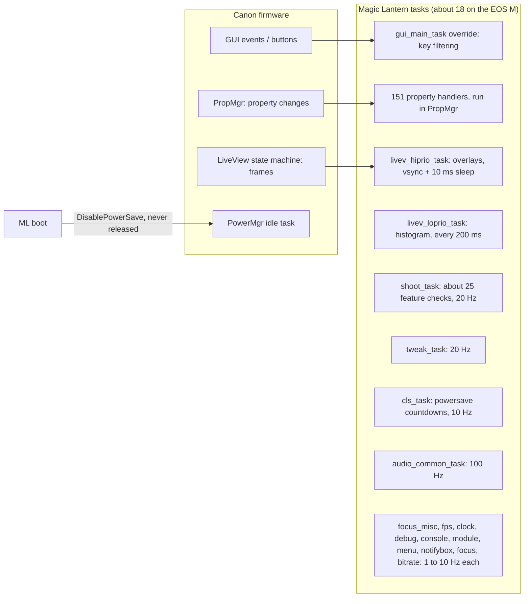
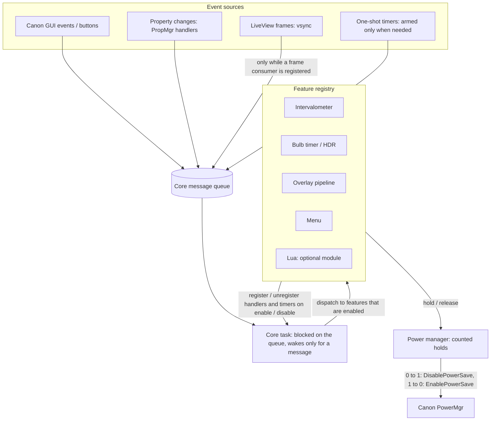
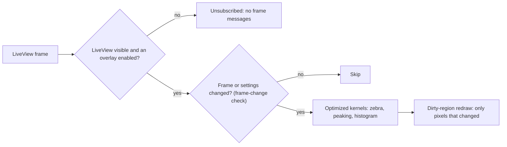

# Architecture: Magic Lantern today, Penumbra's target

This document describes how Magic Lantern (ML) runs next to Canon's firmware on the EOS M today, and the
event-driven core that Penumbra is moving towards. It ends with a progress table and the numbers measured so
far.

Penumbra is based on Magic Lantern (<https://github.com/reticulatedpines/magiclantern_simplified>). The
"today" half describes upstream's design as it is in this repository. It is not a criticism of upstream: the
polling design is simple and robust, and it was built for many camera models and for video. Penumbra's
goals are narrower: one camera, stills, and battery life.

## 1. Background: how the camera saves power

Three Canon mechanisms matter. They are described in detail in
[firmware/1100D-powersave.md](firmware/1100D-powersave.md), which covers the 1100D. The EOS M (DIGIC 5) has not
been reverse engineered yet and may differ.

- **Auto power off (APO).** This turns the camera off after the configured idle time. Penumbra leaves it
  alone.
- **The power-save counter.** Canon's `DisablePowerSave` / `EnablePowerSave` eventprocs are a nested counter.
  While it is above zero, Canon's `PowerMgr` idle task uses a plain wait-for-interrupt at full clock. At zero,
  idle uses a wait-for-interrupt at a lowered clock. If the image engine is unclocked and nothing has
  re-armed the counter for about one second, idle enters a **self-refresh deep sleep**, which gates all module
  clocks (DryOS timers included) until a key or MPU event. Canon raises the counter around its own activities:
  LiveView, movie recording, USB, file jobs, display transitions and boot.
- **Display and sensor power.** These are driven by Canon's LiveView and display state machines.

Upstream ML calls `DisablePowerSave` once at boot and never releases it, so the camera never reaches the
lowered-clock idle or the deep sleep. ML did this on purpose: its timer-driven features (intervalometer,
display-off timers) stopped during deep sleep. In LiveView this costs nothing extra, because Canon holds the
counter there anyway. The cost appears in the time spent outside LiveView or with the display off before APO.

## 2. Today: polling tasks

Main traits (details and `file:line` references in [analysis/power-audit.md](analysis/power-audit.md)):

- **Time-driven, not change-driven.** Most tasks wake on `msleep()` or on a queue or semaphore with a timeout,
  check a few flags, and go back to sleep. A task wakes even if its feature is off. The estimated sum at
  LiveView idle with default settings is **about 264 ML wakeups/s** (estimate, from the source).
- **Every feature always present.** A feature that is off still has its checks inside the shared loops
  (`shoot_task`, `tweak_task`, `cls_task`), and its task still runs.
- **Overlays redraw on a timer.** The overlay task wakes on every display frame and draws zebras, peaking and
  the other overlays without checking whether the image or the settings changed. The histogram runs every
  400 ms. With the default RAW histogram, a RAW shooter keeps LiveView in raw mode, which copies every raw frame
  over EDMAC.
- **Power save blocked globally.** The single boot-time `DisablePowerSave` covers every feature, whether or
  not one is running.
- **Lua and modules** hook the shared loops through callbacks (`CBR_SHOOT_TASK` at 20 Hz, `CBR_VSYNC`,
  `CBR_SECONDS_CLOCK`).

## 3. Target: an event-driven core

The goal is that **when nobody touches the camera and no feature is running, ML does no work at all**, and
that Canon's own power-save logic decides how deeply the camera sleeps.

### 3.1 Event sources and the core task

- One ML core task blocks on one message queue with no timeout. Canon GUI events, property handlers, LiveView
  frame notifications and timer callbacks only post a short message. They never do the work in their own
  context.
- Timers are one-shot (`SetTimerAfter`-style) and are armed by the feature that needs them, for the time it
  needs. A countdown is a timestamp plus a timer, not a 10 Hz loop.
- Existing tasks move into the core one at a time, using the strangler pattern. Each migration is verified in
  emulation before the next one starts. Tasks that must stay separate for latency or stack reasons, such as the
  shooting sequence, block on their own queue with no timeout.

### 3.2 Features register only when enabled

A feature registers its handlers, timers and frame subscriptions when the user enables it, and removes them
when it is disabled. A disabled feature costs nothing at runtime: it is "cold". This replaces the shared loops
that check about 25 feature flags 20 times a second.

### 3.3 Overlay pipeline

- Frame messages flow only while LiveView is visible and at least one overlay is on.
- A cheap frame-change check (for example, a sparse luma signature, or lens, exposure and settings properties)
  skips frames that would produce the same overlay.
- The pixel loops are the optimized kernels already on `main` (`src/overlay_kernels.c`). They produce the same
  output as the original loops, bit for bit, with fewer instructions.
- Redraw writes only the pixels whose overlay value changed, as peaking's dirty-pixel restore already does.
- The histogram runs on demand (exposure change, half-shutter) or at a capped rate, and by default from the YUV
  frame, so LiveView does not stay in raw mode.

### 3.4 Power manager: counted holds

- ML no longer disables power save at boot. A feature that must keep running **from timers with nobody touching
  the camera** (intervalometer, bulb timer, HDR sequence, a running Lua script, ML's own card I/O) takes a named
  hold for the time it runs: `powersave_hold("intervalometer")` / `powersave_release(...)`.
- Holds are counted per name. Canon sees at most one hold from ML: the total's 0→1 edge calls
  `DisablePowerSave`, and 1→0 calls `EnablePowerSave`. So ML can never underflow Canon's counter.
- With no hold, Canon's own logic decides: low-clock idle, or self-refresh deep sleep once the image engine is
  off (display off, outside LiveView). Anything driven by a key, the shutter or an MPU message wakes the
  camera by itself and needs no hold.
- ML must also stop raising Canon's counter indirectly. The lens-info poll did this: it asked the MPU for lens
  data once a second, and Canon brackets that traffic with Disable/Enable.

### 3.5 Lua

Lua stays an optional module. A running script holds power save, so it behaves as it did upstream. Lua is never
in a hot path: frame or tick callbacks for scripts are registered only while a script asks for them.

## 4. Where we are

Branch names refer to this repository. The power branches are stacked: `power/low-risk` →
`power/powersave-hold` → `power/lens-poll` → `power/sd-safe`. Each one contains the previous one.

| Item | State | Where |
|---|---|---|
| Photo build profile (video, audio, dev features and modules removed) | Done | merged (`main`) |
| Overlay pixel kernels (zebras, peaking, histogram), bit-exact, host-tested | Done | merged (`main`) |
| Emulation harness: QEMU wakeup plugin, 1100D scenarios, ROM handling | Done | merged (`main`) |
| 1100D power-save reverse engineering | Done | merged (`main`, [firmware/1100D-powersave.md](firmware/1100D-powersave.md)) |
| Low-risk wakeup reductions: `tweak_task` 2 Hz, waits with no timeout, housekeeping polls, intervalometer spin | Done | branch `power/low-risk` |
| Counted power-save hold API, boot hold, holders audit | Done | branch `power/powersave-hold` |
| Lens-info poll outside LiveView only when a consumer exists | Done | branch `power/lens-poll` |
| Pulled, prebuilt QEMU image (faster emulation job) | Done | branch `emulation-image` |
| SD-safe file I/O: a hold around every ML card operation, idle trace files closed, `sd_clock` holds while overclocked | In progress | branch `power/sd-safe` |
| Deep-sleep emulation: PowerMgr registers and self-refresh modelled in QEMU | In progress | separate QEMU fork |
| EOS M ROM dump and emulation; EOS M PowerMgr reverse engineering | To do | needs the camera |
| Event core, step 1: core task + queue, one-shot timer service | To do | |
| Event core, step 2: `cls_task` (powersave countdowns, LED, cropmarks) → timers + key events | To do | |
| Event core, step 3: `clock_task` → lazy clock + 1 s timer only while a consumer exists | To do | |
| Event core, step 4: overlay pipeline (frame subscription, change check, dirty redraw, one wake per frame) | To do | |
| Event core, step 5: histogram on demand, YUV by default | To do | |
| Event core, step 6: `shoot_task` event-driven, polling only for features that need it | To do | |
| Event core, step 7: `tweak_task` and `debug_task` into the core | To do | |
| Event core, step 8: Lua and module callbacks registered on demand | To do | |
| Hardware validation and A/B battery protocol | To do | last step |

### Numbers so far

Labels: **measured** comes from a CI run or a test; **estimate** is computed from the source code.
No number here is a battery measurement.

| What | Value | Kind | Camera / setup |
|---|---|---|---|
| ML wakeups/s at LiveView idle, upstream defaults | ~264/s | estimate | EOS M source (sum of task rates, [power-audit.md](analysis/power-audit.md)) |
| Same, photo profile after the low-risk fixes | ~103/s | estimate | EOS M source (`power/low-risk`) |
| Task switches added by ML at idle (outside LiveView) | ~290/s (Canon alone 68/s, upstream ML 357/s) | measured | 1100D in QEMU, `full` build |
| `audio_common_task` alone | ~100 switches/s | measured | 1100D in QEMU (matches the 100 Hz estimate) |
| Canon power-save counter changes at idle with ML loaded | 3.3-3.7/s before → **0** after the lens-poll fix | measured | 1100D in QEMU, 30 s window, `full` and hold builds |
| Canon power-save counter at idle | 1 (upstream ML) → **0** with holds, ML holds 0 | measured | 1100D in QEMU, hold build |
| Overlay kernels | 1.29× to 3.56× fewer instructions, depending on kernel ([details](analysis/overlay-kernels.md)) | measured | ARM926 instruction counts, camera compiler, emulated CPU, synthetic frames (host) |

What these numbers do not show yet:

- **Deep sleep.** The QEMU model does not emulate the PowerMgr hardware, so the self-refresh sleep cannot happen
  in emulation yet. With the counter at 0, the emulated idle loop spins instead of sleeping, which is an
  emulation artifact (see [LIMITS.md](LIMITS.md)).
- **LiveView.** The emulator has no LiveView sensor path, so the overlay and frame costs come from host
  benchmarks and from estimates.
- **The EOS M itself.** All measurements so far are on the 1100D. The EOS M waits for a ROM dump.

## 5. Design rules

- Stay in C. The cost comes from the polling architecture, not the language. Hand-written ARMv5TE assembly is
  only allowed for proven hot pixel loops, and only with bit-exact host tests.
- Never hold Canon awake longer than Canon itself would, and never block APO.
- `ML_PROFILE=full` stays an upstream-equivalent reference build, so every change can be compared with
  upstream on the same runner.
- Every change that touches power behaviour is checked in emulation before it is merged. Hardware is last.
